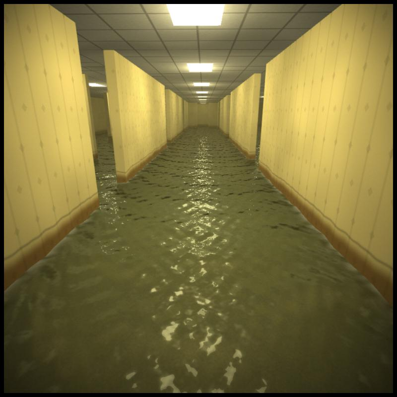
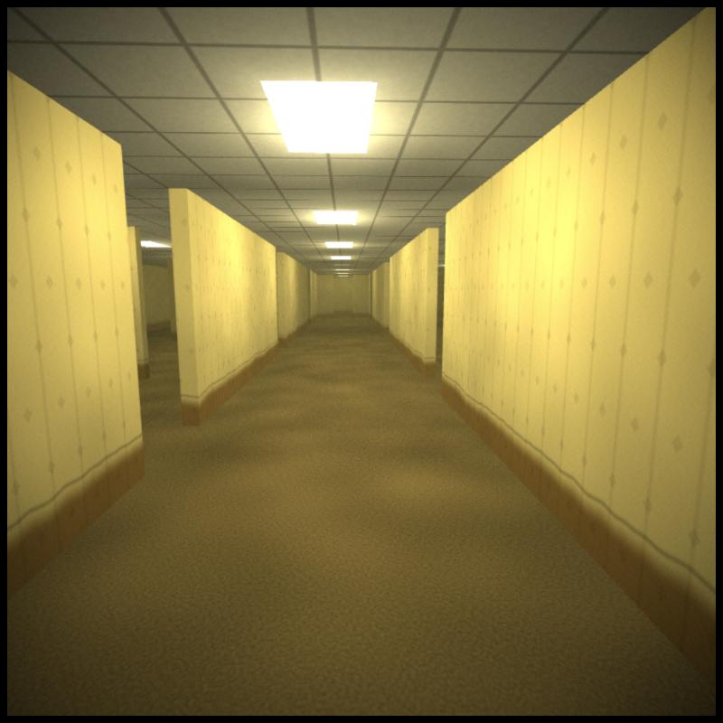
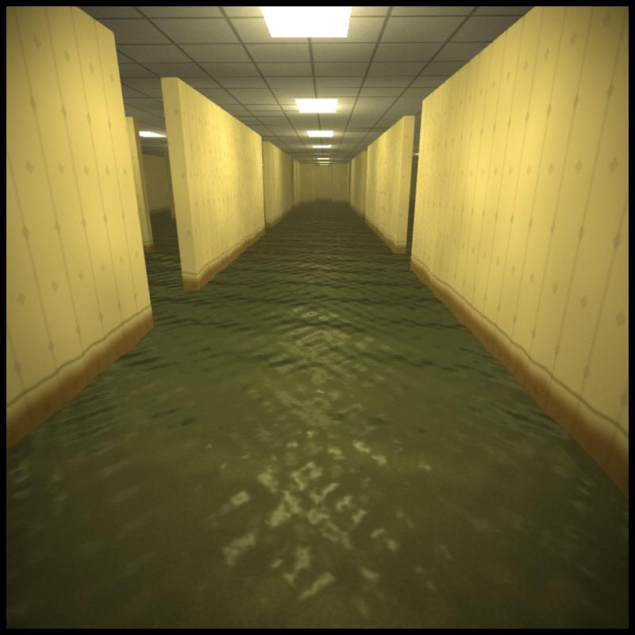
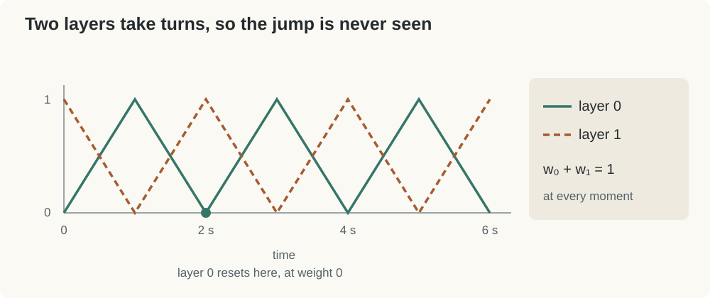
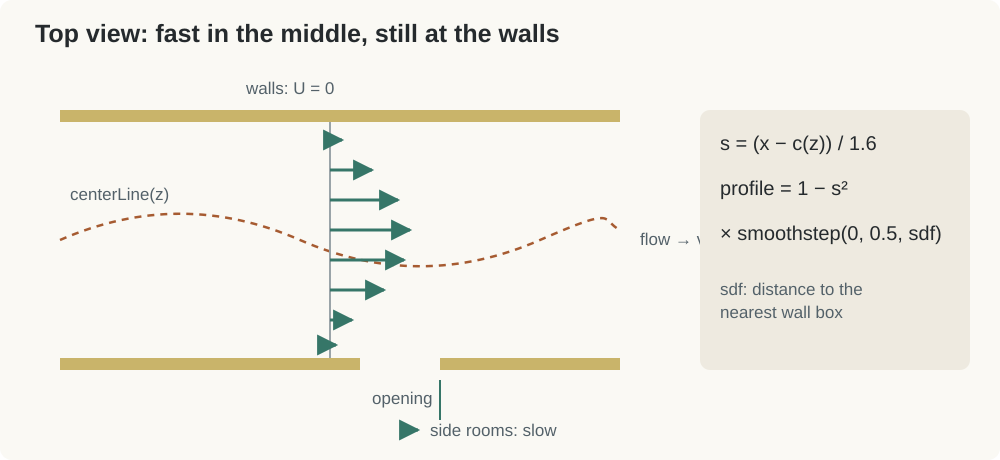
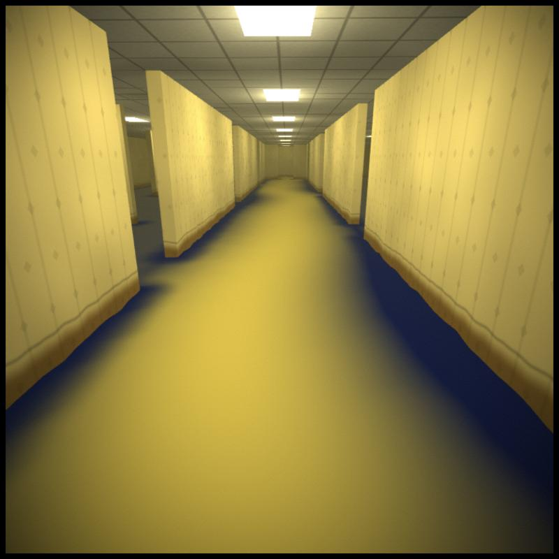
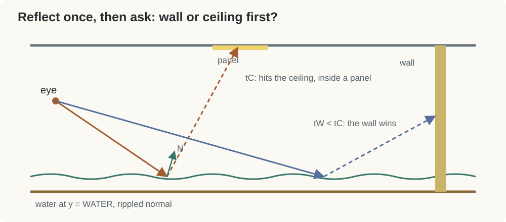

# Flooding the Corridor: A River Through Level 0

The first two rooms were dry, or close to it. The pool had water, but it was flat and it stayed where it was. This time I wanted the classic yellow corridor with a few centimeters of murky water running through it, flowing past the walls and out through the doorways.

The water idea comes from a river I built for coursework. A small stream winds across a sandy bank, ripples get carried downstream, and the shallow edges turn to foam. A flooded corridor turned out to be a pretty good place to reuse it. The walls are the riverbanks now.

The scene is [`flooded_corridor.html`](flooded_corridor.html). It uses a different framework from the earlier rooms, so we start there.



## 1. From Rays to Triangles

Level 0 and the Poolrooms drew two triangles over the screen and traced a ray for every pixel. Here we go back to the regular route: build triangle meshes in JavaScript, send them to the GPU, and let it rasterize them. The base [`webgl2.js`](webgl2.js) comes from the same course. It draws a list of `shapes`, and each shape has its own vertices, material, and matrix.

Every vertex holds 8 numbers: position, normal, and UV.

```js
this.vertexSize = 8;
this.vertexAttributes = {
   aPos: { size: 3, position: 0 },
   aNor: { size: 3, position: 3 },
   aUV:  { size: 2, position: 6 },
};
```

I build everything directly in world space: $x$ to the right, $y$ up, $z$ toward the viewer. The floor is at $y=0$, the ceiling at $y=2.7$. That way the fragment shader can light a point using its world position and normal, with no model transforms in between.

The camera is one matrix, shared by every shape:

```js
m.identity();
m.scale(1.3, 1.3, 1);
m.perspective(1);
m.move(0, 0, 1);              // put the eye at z = 1, the focal point of perspective(1)
m.turnX(0.05 - look[1]);
m.turnY(look[0]);
m.move(-eye[0], -eye[1], -eye[2]);
```

Read it from the bottom up, because that's the order applied to a point. Move the world so the eye sits at the origin, turn it, then push it so the eye lands at $z=1$. `perspective(1)` sets $w = 1 - z$, so dividing by $w$ shrinks things with distance. The scale at the end works as a zoom.

There's a catch here. The course framework divides by $w$ inside the vertex shader. That's fine for an object floating in front of the camera. But we are standing *inside* the room, so some wall triangles reach behind us. Behind the eye, $w$ goes negative and the division flips those vertices to the other side of the screen. You'd get long streaks.

The fix is to hand $w$ to the GPU and let it do the division itself:

```glsl
gl_Position = vec4(pos.x, pos.y, -pos.z, pos.w);
```

The GPU clips triangles *before* dividing, so whatever is behind the camera gets cut away cleanly. The `-pos.z` keeps the same depth direction the framework used.

## 2. The Walls Are a List of Boxes

The whole layout is one array. Each wall is a box on the floor plan, `[xmin, zmin, xmax, zmax]`, and every one runs from floor to ceiling:

```js
let walls = [
   // outer boundary
   [-8.2,-34.2, 8.2,-34], [-8.2, 4, 8.2, 4.2], [-8.2,-34,-8, 4], [8,-34, 8.2, 4],
   // main corridor, left and right sides with openings
   [-1.8,-34,-1.6,-24], [-1.8,-22,-1.6,-14], [-1.8,-12.5,-1.6,-6], [-1.8,-4.5,-1.6, 4],
   ...
];
```

The gaps between segments are the openings to the side rooms. At the far end, two short boxes leave a doorway.

That array gets used three times. JavaScript turns each box into four quads to draw. The same numbers are also written into the shader as a constant:

```js
const vec4 WALLS[NW] = vec4[NW](${walls.map(w => `vec4(${w.map(f).join(',')})`).join(',')});
```

Inside the shader, the water uses the array for two things: how far a point is from the nearest wall, and what a reflected ray hits. One list, three uses, and the water always agrees with the walls you can see.

The distance part is a standard box distance function:

```glsl
float boxSDF(vec2 p, vec4 b){
   vec2 d = abs(p - 0.5*(b.xy + b.zw)) - 0.5*(b.zw - b.xy);
   return length(max(d, 0.)) + min(max(d.x, d.y), 0.);
}
```

`d` is how far $p$ is past the box's edges on each axis. Outside the box, the length of the positive part is the distance to it. `wallSDF` takes the minimum over every box. We'll lean on it a lot.

## 3. Wallpaper, Carpet, Ceiling

Each surface is its own shape with its own Phong material, written like the materials in the earlier rooms:

```js
let wallpaper   = { ambient: [.22,.19,.08], diffuse: [.86,.77,.42], specular: [.10,.09,.05,12], roughness: 0.0, opacity: 1.0 };
let carpet      = { ambient: [.12,.10,.04], diffuse: [.55,.45,.21], specular: [.03,.03,.02, 4], roughness: 0.0, opacity: 1.0 };
let ceilingTile = { ambient: [.44,.42,.32], diffuse: [.80,.77,.62], specular: [.05,.05,.05, 6], roughness: 0.0, opacity: 1.0 };
```

The framework only sends material values to the shader, not a surface type. That's okay, because the normal already tells us what we're looking at. Facing up means carpet, facing down means ceiling, anything else is wall:

```glsl
else if (N.y >  0.5) color = shade(P, N, carpetTex(P, amp));
else if (N.y < -0.5) color = shade(P, N, ceilingTex(P)) + ceilingEmission(P.xz);
else                 color = shade(P, N, wallTex(P, N));
```

Each `...Tex` function returns a value near 1 that multiplies the material's color. The wallpaper has faint vertical stripes and a small diamond on every other row, shifted by half a step. Both come from `fract()` of the wall coordinates, the same repeat trick as the pool tiles.

The lighting is Level 0 again. Panels sit on a grid, here $4.5$ apart in $x$ and $4$ in $z$. For each point, we add up the diffuse and specular from the nearby cells. The corridor is long and narrow, so it checks a $3\times5$ block instead of $3\times3$. One tube is dead and one flickers:

```glsl
if (cell == vec2(1., -6.)) return 0.0;                        // dead tube
if (cell == vec2(0., -5.))                                    // flickering tube
   return noise(vec3(uTime * 7.0, 3.1, 0.7)) > 0.12 ? 0.15 : 1.0;
```

A flood leaves a mark on the walls, so I gave it one. Just above the waterline, the wallpaper soaks brown and fades upward, with a thin darker tide line where it stops:

```glsl
float h = WATER + 0.25 + 0.10 * noise(vec3(u * 1.1, 0.0, 3.0)) + 0.03 * noise(vec3(u * 6.0, 0.0, 1.0));
float soak = 1.0 - smoothstep(h - 0.15, h, P.y);
float tide = exp(-pow((P.y - h) / 0.015, 2.0));
```

The stain height wanders along the wall because of the noise in `h`. A perfectly level stain looks painted on.



Now the room is ready to flood.

## 4. Waves as a Sum of Sines

The water surface is a flat grid at $y = 0.12$, laid over the whole floor. Waves come from adding up five sines, each with its own wavelength $\lambda$ and direction $d$:

$$
h(p,t)=\sum_i A_i\sin(k_i\, d_i\cdot p-\omega_i t),
\qquad k_i=\frac{2\pi}{\lambda_i}
$$

A single sine looks like corrugated metal. Five of them at different angles look a lot more like water, because their crests keep crossing in different places.

Wave speed shouldn't be arbitrary. On real water, long waves move faster than short ones. For deep water, $\omega=\sqrt{gk}$. I use $0.4$ in place of $g$, which fits this scale better:

```glsl
float k = (2.*3.14159) / lam[i];
float w = sqrt(0.4*k);
float A = amp * lam[i] / 60.;
```

The amplitude scales with wavelength, so every wave has the same steepness. Small ripples stay small.

We need more than the height. Lighting needs a normal, and for a surface $y=h(x,z)$, the normal comes from its slope:

$$
N=\text{normalize}\left(-\frac{\partial h}{\partial x},\ 1,\ -\frac{\partial h}{\partial z}\right)
$$

Taking the derivative of a sine just turns it into a cosine, so the slope comes for free inside the same loop:

```glsl
r.x  += wt*A * sin(theta);
r.yz += wt*A * k * cos(theta) * d;
```

The vertex shader uses the height to move the grid up and down. The fragment shader calls the same function again for the normal, at every pixel. That way the ripples stay sharp even though the grid is only $0.25$ units per square.

Far away, those ripples get smaller than a pixel and start to flicker. So the fragment shader fades them out with distance:

```glsl
float amp  = exp(-0.07 * dist);    // fade small ripples with distance to avoid shimmering
```



That's a pond. Now it needs to go somewhere.

## 5. Making the Water Flow

To carry the waves downstream, we can shift where we sample them. If the water moves at velocity $v$, then what's at $p$ now was at $p - v\,t$ a moment ago:

$$
h_{\text{flow}}(p,t)=h(p-v\,t,\ t)
$$

This works where $v$ is constant. But the water should move faster in the middle than at the walls. As $t$ grows, the fast part drifts further and further from the slow part, and the pattern stretches until it's just streaks.

The usual fix is to never let $t$ grow too large. Use a phase that restarts every 2 seconds, so the offset never gets far. On its own, though, every restart is a visible jump. So we run **two layers**, half a period apart, and blend them with triangle weights:

```glsl
for (int layer = 0; layer < 2; layer++){
   float ph = fract(t / 2.0 + 0.5 * float(layer));
   float wt = 1.0 - abs(2.0*ph - 1.0);
   vec2 q = p - vel * 2.0 * ph;
   ...
}
```

Each layer restarts exactly when its weight is zero, so the jump is invisible. The other layer is at full weight right then, and the two weights always add to one.



This is the same thing my river does, line for line. The one change is the direction. Angles are now measured from $+z$, the way the water flows, so `d = vec2(sin(a), cos(a))`.

## 6. Where Is the Water Fast?

In the river, speed depended on how far you were from the center of the channel. Write the offset as $s$, from $-1$ at one bank to $1$ at the other. Then $1-s^2$ is fastest in the middle and zero at the banks, the classic profile for flow in a channel.

The corridor works the same way, with the walls as banks. I also let the center line wander a little, so the stream doesn't run in a perfectly straight line:

```glsl
vec2 flowVel(vec2 p){
   const float U0 = 0.6;
   float s = clamp((p.x - centerLine(p.y)) / 1.6, -1.0, 1.0);
   float inCorridor = 1.0 - smoothstep(1.6, 2.0, abs(p.x));
   float profile = mix(0.25, 1.0 - s*s, inCorridor) * smoothstep(0.0, 0.5, wallSDF(p));
   return U0 * profile * normalize(vec2(centerLineD(p.y), 1.0));
}
```

Two more factors take care of the layout. Out in the side rooms, the water just drifts at a quarter of the speed. And the `wallSDF` factor slows everything to zero within half a unit of any wall. That includes pillars and the edges of the doorway, which a single $s$ could never describe.

The direction follows the center line's slope, `centerLineD`. Where the stream bends, the water bends with it.



To check it, I temporarily colored the water by speed, blue for still and yellow for fast:



The yellow band follows the corridor and narrows near the walls. Out in the side rooms it fades to blue.

## 7. Looking Into the Water

Shallow water shows you the floor. At a low angle, it shows you a reflection. Two numbers decide the balance.

The first is how much light makes it through. The river darkened its bed with $T=e^{-l}$, where $l$ is how much water the light passes through. Here the depth is the same everywhere, but your viewing angle isn't. Looking straight down, you see through about $0.12$ of water. Looking down the corridor, the ray travels sideways through it for a long way:

```glsl
float pathLen = WATER / max(V.y, 0.05);
float T = exp(-3.0 * pathLen);
```

The second is Fresnel. Glancing views reflect more:

```glsl
float F = 0.15 + 0.85 * pow(1.0 - max(0., dot(nor, V)), 4.0);
```

Both go into how opaque the water is:

```glsl
color = mix(murk, refl, F);
alpha = clamp(OPACITY + 0.75 * (1.0 - T) + F, 0.0, 1.0);
```

The carpet is drawn before the water, and the water is blended on top of it. Close to your feet, alpha is low and the carpet shows through. Further down the corridor, alpha reaches one and the water acts like a mirror. That's why the water shape comes last in `this.shapes`.

`murk` is the water's own color, a yellow-green, lit by the same panels. In the material it's stored as the water's `diffuse`.

## 8. One Bounce of Reflection

A Phong highlight only gives round spots. A fluorescent panel is a rectangle, and it should show up in the water as a wobbly rectangle. So the shader traces one reflected ray.

Reflect the view direction about the wave normal. Then check two candidates:

- **The ceiling**, a flat plane: $t_C = (H - P_y)/R_y$.
- **The walls**, using Level 0's slab test in 2D, against every box in `WALLS`.

```glsl
vec2 t0 = (WALLS[i].xy - P.xz) / d, t1 = (WALLS[i].zw - P.xz) / d;
vec2 tn = min(t0, t1), tf = max(t0, t1);
float tNear = max(tn.x, tn.y), tFar = min(tf.x, tf.y);
```

The walls run all the way from floor to ceiling, so a 2D test on the floor plan is enough. And the $t$ along $R_{xz}$ is the same $t$ along the full 3D ray.

Whichever is closer wins. If it's the ceiling, we check whether the hit point lands inside a panel using the same `ceilingEmission` grid that draws the panels. If it's a wall, we sample the wallpaper there.



It's only one bounce, and nothing here casts shadows. Still, the water now shows the lights, the yellow walls, and the ceiling grid, all bent by the same ripples that move the surface.

## 9. Foam, Caustics, and a Bit of Footage

The river put foam where the water got shallow, $e^{-15\cdot\text{depth}}$. A flooded floor has the same depth everywhere, so I measure distance to the wall instead:

```glsl
float n = noise(vec3(P.x * 7.0, P.z * 7.0 - uTime * 1.5, uTime * 0.4));
float Iedge = exp(-wallSDF(P.xz) / 0.07) * smoothstep(-0.25, 0.25, n + 0.1);
```

The noise breaks the foam into patches. Its $z$ coordinate shifts over time, so the patches drift downstream.

Under the water, the carpet picks up a fake caustic. Wherever the wave height is positive, the carpet gets a little brighter:

```glsl
float caustic = 1.0 + 0.6 * smoothstep(0.0, 0.025, h);
```

Real caustics come from light bending as it passes through the surface. This just borrows the wave pattern. It's cheap, though, and it moves with the water above.

To finish, distance fades everything toward a dim yellow fog. A vignette and some film grain make it look a bit like old camcorder footage. The camera wades slowly down the corridor and back, and the mouse turns your head.

## 10. What's Left

There are a few obvious holes. Nothing casts shadows, so light leaks through walls into the side rooms. The floor under the water isn't refracted, so the carpet doesn't bend with the ripples. The reflection stops after one bounce. And the waves only *look* like they flow around walls. They're advected, not simulated, so nothing piles up against a corner.

For now, that's enough. A box of walls, a list of numbers reused three times, and a river borrowed from somewhere else. Together they turn Level 0 into somewhere you'd rather not be standing.

## Source

- Scene: [`flooded_corridor.html`](flooded_corridor.html)
- Course framework: [`webgl2.js`](webgl2.js), [`library.js`](library.js)
- Previous tutorials: [Building Level 0](../level0/level0.md), [Building the Poolrooms](../swimming_pool/swimming_pool.md)
