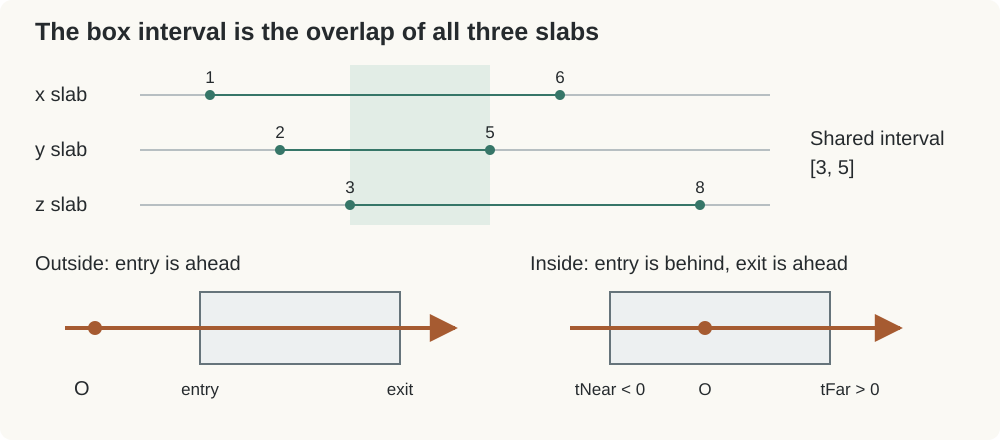
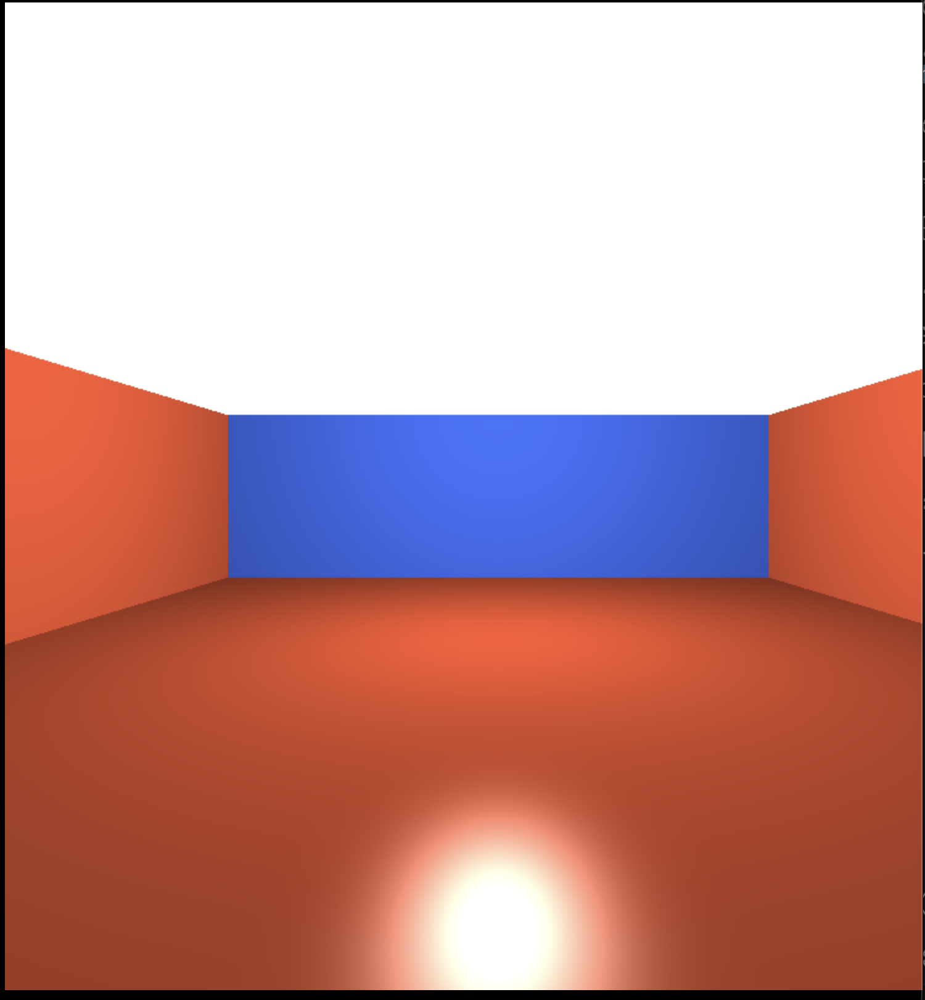
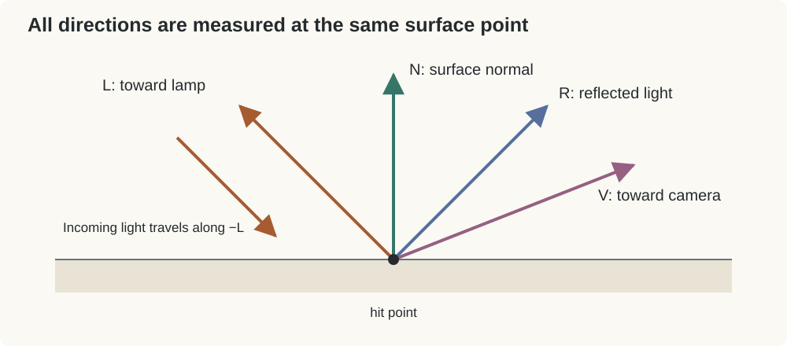
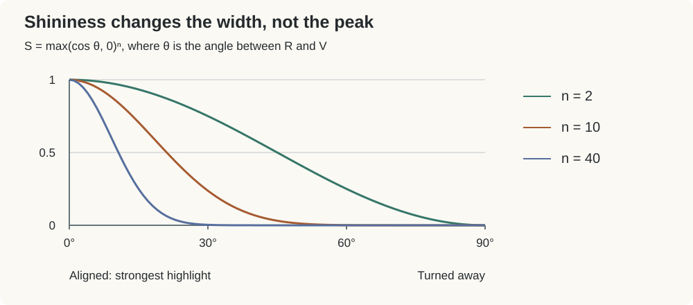
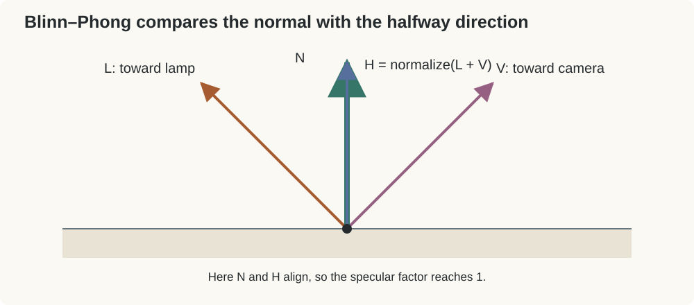
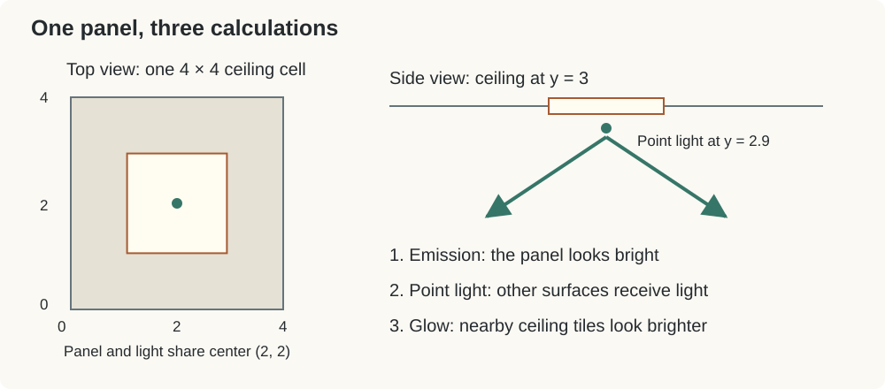
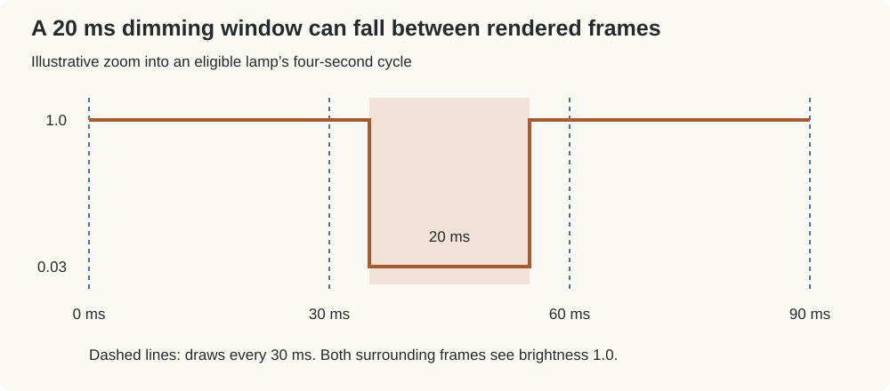

# Building Level 0: From a Box to a Room Full of Light

The ingredients of the Backrooms are almost painfully ordinary: yellow walls, carpet, a ceiling, fluorescent lights. Repeat them far enough, and something familiar starts to feel uncomfortable.

That is what I want to build here. But first, I want to understand what makes the image work. How does a pixel find a wall? Why does tilting a surface make it darker? Why does a bright patch on the floor move with the camera?

We start with the exterior cube in [`scene3_trial.html`](scene3_trial.html), turn it into a room, then follow the lighting in [`level0.html`](level0.html). The screenshots are landmarks from earlier stages; the code excerpts describe the current implementation.

## 1. Step Inside the Box

The browser draws two triangles across the canvas, giving the fragment shader a place to run. Each pixel constructs a viewing ray:

$$
P(t)=O+tD
$$

Start at the camera $O$, move along direction $D$, and $t$ tells us how far to go. Positive $t$ is ahead; negative $t$ is behind. Our task is to find where that ray reaches a surface.

### Three slabs make a box

A slab is the space between two parallel planes. A box is the overlap of three slabs, one for each axis.

For the $x$ slab, the boundaries are $x=-b_x$ and $x=b_x$. Substituting the ray equation gives their crossing times:

$$
t=\frac{\pm b_x-O_x}{D_x}
$$

Do that for all three axes, then sort each pair into an entry and an exit:

```glsl
vec3 t0 = (-boxSize - rayOrigin) / rayDir;
vec3 t1 = ( boxSize - rayOrigin) / rayDir;
vec3 tMin = min(t0, t1);
vec3 tMax = max(t0, t1);
```

The division happens component by component. Sorting matters because the ray can travel in either direction. Also, `boxSize` is a half-size: the planes sit at `-boxSize` and `boxSize`.



We must be inside **all three slabs** to be inside the box. That means taking the latest entry and the earliest exit:

```glsl
float tNear = max(max(tMin.x, tMin.y), tMin.z);
float tFar  = min(min(tMax.x, tMax.y), tMax.z);
```

For intervals $[1,6]$, $[2,5]$, and $[3,8]$, the overlap is $[3,5]$. If the latest entry comes after the earliest exit, there is no intersection. We also need an exit ahead of the camera: `tFar > 0.0`.

### The room is the exit surface

Outside the box, we see its entry face at `tNear`. Inside, that entry is behind us. The wall ahead is at `tFar`:

```glsl
float tHit = tFar;
vec3 hit = rayOrigin + tHit * rayDir;
```

Simply moving the starter's camera inside would not be enough. Its `max(tNear, 0.0)` would select zero—the camera position. Choosing the exit is what turns the cube into a room.

The axis that supplied `tFar` identifies the face we hit. Its normal must point inward: the ceiling faces down, $(0,-1,0)$, and the floor faces up, $(0,1,0)$. Those directions will matter when we add light.



Here is the first interior. Just the room, with no pillars yet. Now we have somewhere to stand—and something to illuminate.

## 2. What Makes a Surface Look Lit?

I find lighting easier to understand by pausing at one surface point. The whole image is this little calculation repeated across pixels.

We need three unit directions: the surface normal $N$, the direction toward the light $L$, and the direction toward the viewer $V$. In the code, they are `normal`, `Ln`, and `-rayDir`. The minus sign reverses our viewing ray so it points back toward the camera.



### Diffuse: spread the light over the surface

Imagine shining a flashlight onto a tabletop. Straight down, its beam covers a compact patch. Tilt it, and the same beam spreads over a larger area. Each unit of surface receives less light.

For unit vectors, the dot product captures that angle:

$$
N\cdot L=\cos\theta
$$

Facing the light gives $1$. At $60^\circ$, we get $0.5$. Sideways, we get $0$. Negative values mean the light is behind the surface, so we clamp them to zero:

```glsl
float ndl = max(0.0, dot(normal, Ln));
diffuseSum += LIGHT_COL * ndl * atten;
```

This is Lambert diffuse lighting. At a fixed surface point, moving the viewer alone does not change it. The light and surface orientation determine the result.

`albedo` supplies the material color. Multiplying it by the illumination makes a yellow wall respond differently from a gray ceiling. It describes what the material contributes, rather than fixing how bright it must appear.

Distance matters too. Our shader uses:

```glsl
float atten = brightness / (1.0 + ATTEN_K * d2);
```

`d2` is squared distance to the lamp. Farther lamps contribute less; `ATTEN_K` controls how quickly that happens. This is a convenient artistic falloff, rather than an exact physical model.

Finally, `AMBIENT` adds a little constant illumination so unlit areas remain visible. A real room receives bounced light from its surroundings. Here, ambient is a simple stand-in for those missing bounces.

### Specular: bring the viewer into the calculation

Diffuse explains broad shading. A specular highlight asks something else: are we looking close to the direction in which the light would reflect?

Think of a small mirror lying flat. You only see a lamp in it from suitable positions. That dependence on the viewer is the idea behind the floor highlight.

The current shader uses **Phong specular lighting**:

```glsl
vec3 R = 2.0 * dot(normal, Ln) * normal - Ln;
specSum += pow(max(0.0, dot(-rayDir, R)), 10.0) * atten;
```

$R$ is the ideal reflected direction. The term $(N\cdot L)N$ extracts the part of $L$ along the normal; doubling it and subtracting $L$ gives the reflection of incoming light traveling along $-L$.

Then we compare $R$ with the viewing direction:

$$
S_{\text{Phong}}=\max(0,R\cdot V)^n
$$

When they align, the dot product is $1$ and the highlight is strongest. As they separate, the value shrinks. Raising it to a power makes it fall away faster.



For a dot product of $0.8$, squaring gives $0.64$, but raising it to the tenth power gives only about $0.107$. A larger exponent makes a narrower highlight. It does not raise the peak: $1^n$ is still $1$.

Our exponent, `10.0`, gives a broad highlight. A separate coefficient, `0.25`, controls its strength. Width and brightness are different controls.

This is why a floor highlight can follow the camera: it depends on $V$. The shader calculates it only for the floor, and it does not trace a reflected image of the scene.

### And Blinn–Phong?

Blinn–Phong describes a similar glossy effect using a different comparison. It constructs the halfway direction between the light and viewer:

$$
H=\frac{L+V}{\lVert L+V\rVert}
\qquad
S_{\text{Blinn}}=\max(0,N\cdot H)^m
$$



If $N$ aligns with $H$, the surface is oriented to reflect the light toward the viewer. Phong compares **reflection with view**; Blinn–Phong compares **normal with halfway direction**. Their exponents give different highlight widths, so the same number is not an exact match.

Our scene keeps the Phong version. Understanding both helps separate the idea—a highlight that depends on viewing direction—from the particular formula.

### Put it together

```glsl
color = albedo * (AMBIENT + diffuseSum) * ao
      + specSum * 0.25 * LIGHT_COL;
```

The material colors the ambient and diffuse terms. `ao` darkens them near room corners. Specular is added separately, tinted by the lamp color. The sums collect contributions from nine nearby lights.

One useful experiment: keep the light and surface fixed, then move the camera. Diffuse stays the same at that point; specular changes. Move the light instead, and both change. That small distinction explains a surprising amount of what we see.

## 3. Give the Ceiling Its Lights

The next stage adds ceiling panels and a first pillar. The materials move toward the yellow palette, but the dark ceiling makes the white rectangles feel disconnected from their surroundings.


A convincing ceiling needs three separate effects: **a bright panel, light falling on the room, and glow around the panel**.



The panel itself is a pattern on the ceiling face:

```glsl
vec2 l = hit.xz - 4.0 * floor(hit.xz / 4.);
vec2 dc = abs(l - 2.0);
float panelMask = 1.0 - smoothstep(0.9, 0.96, max(dc.x, dc.y));
```

The first line repeats a $4\times4$ cell. The second measures distance from its center, `(2,2)`. Taking the larger component creates a square boundary; `smoothstep` softens its edge.

Inside that mask, the shader displays an emissive color. But making a rectangle bright does not automatically illuminate anything else. We separately place a point light just below its center and use the diffuse and specular calculations above. Each hit samples a surrounding $3\times3$ neighborhood of lights.

For the ceiling tiles, we add a soft glow that decreases with horizontal distance from each panel:

```glsl
glow += brightness * exp(-dot(dq, dq) * 0.25);
```

This is a brightness pattern on the ceiling, not a simulated light bounce. It gives the panels some connection to the surface around them.

The visible mask and light positions now share the same center. Earlier, they were offset by one unit along both axes. The mask also now uses ascending `smoothstep` bounds, giving it a defined edge fade.

## 4. Repeat the Ordinary Things

Pillars use the same slab intersection as the room, with one change: we see their **entry** surface. If a pillar's entry is closer than the room wall, it becomes the visible hit.

Repeat those boxes into the distance, add ceiling seams, carpet grain, and wallpaper variation, and the room starts to find its character.


These surface patterns change the material color while leaving the geometry flat. Fog softens the distance; tone mapping compresses bright lighting values; gamma encoding prepares the result for display. They help finish the image, while the intersection and lighting remain its foundation.

## 5. Let a Few Lights Misbehave

A perfectly steady grid of lamps gives us a room. A small interruption makes us notice it.

JavaScript sends elapsed seconds to the shader through `uTime`. Each panel also has an integer grid coordinate, its `id`. A deterministic hash of that ID gives the lamp a stable identity, so its pixels agree instead of flickering independently.

```glsl
float time = t + hash(id) * 4.0;
float cycle = floor(time / 100.);
bool faulty = hash(id + vec2(cycle, 17.0)) < 0.1;
bool flickering = mod(time, 4.0) < 0.02;
```

The offset spreads lamps across a four-second cycle. Roughly ten percent are eligible to flicker during each 100-second block. Within a brief 20 ms window, another hash decides whether the brightness drops to `0.03` or remains at `1.0`.

That brightness affects the panel's emission, its illumination of the room, and its ceiling glow. One lamp dims coherently, while the others stay on.



There is a catch: drawing is scheduled every 30 ms, so a 20 ms dip can be missed entirely. The timing still leaves room for refinement.

That is where I want to leave this first stage: an empty box becoming a room, a few lighting relationships giving it shape, and a small change over time giving it a little unease.

## References

- [NVIDIA: Blinn / Phong lighting](https://www.nvidia.de/docs/IO/8229/Cg-Advanced-%28Effects%29.pdf)
- [Khronos: `smoothstep`](https://github.com/KhronosGroup/OpenGL-Refpages/blob/main/gl4/smoothstep.xml)
- Source: [`scene3_trial.html`](scene3_trial.html), [`level0.html`](level0.html), [`webgl.js`](webgl.js)
