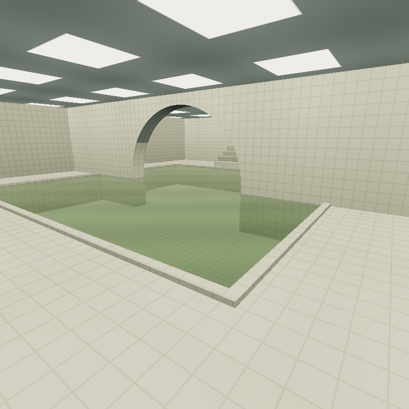
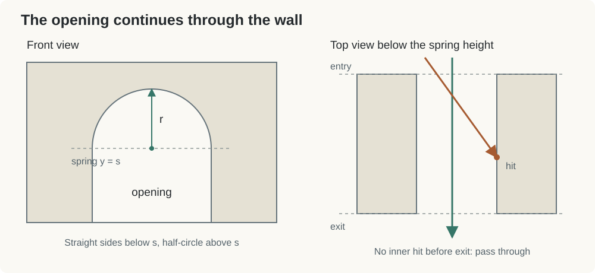
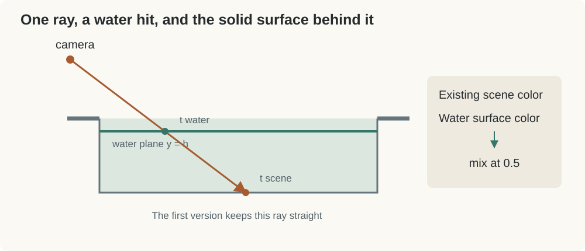

# Building the Poolrooms from Boxes and an Arch

The yellow room already has its lights. For the next space, I wanted an indoor pool: pale tiles, a heavy arch, and water that moves just enough to notice.

Most of the renderer can stay. A pixel still sends out a ray, finds the nearest surface, and works out its color. The interesting part is deciding what counts as a surface when a wall has a hole in it, or when we can see through water.

This follows [`swimming_pool_original.html`](swimming_pool_original.html), the small scene used for these experiments. The [Level 0 tutorial](../level0/level0.md) covers the room intersection and lighting in more detail.



## Start with the Pool and Its Surroundings

The room is still a box viewed from inside. Its exit intersection gives the wall ahead. For objects inside the room, such as the pool deck and stairs, we compare their entry intersections and keep the nearest one.

The pool itself starts with the floor below us. Four solid boxes form a raised deck around it, leaving a lower rectangle in the middle. Thin boxes mark the rim. No special pool primitive is needed.

One detail worth keeping straight: `size` is a half-size. A box centered at $C$ extends from $C-size$ to $C+size$. The central wall uses a half-depth of `0.42`, so its thickness is `0.84`.

At this stage, it is a tiled basin waiting for water. The arch gives us something more interesting to look through.

## Cut an Arch through the Wall

Imagine cutting the same arch out of a stack of cardboard sheets. The front and back have matching holes. Between them, the cut edges become two straight side walls and a curved ceiling.

That is the geometry of `archWall()`: a rectangular solid with an opening extending through its depth. The curved part is the inside of an upper half-cylinder, with its axis along $z$.



### Find the wall interval first

Start by ignoring the hole. The existing slab calculation gives the interval during which the ray is inside the wall's bounding box:

```glsl
vec2 range = boxRange(ro, rd, center, size);
if (range.x > range.y || range.y < 0.002 || range.x > hit.t) return;
float entry = max(range.x, 0.002);
vec3 p = ro + entry * rd;
```

`range.x` is the entry time and `range.y` is the exit time. If the interval is empty or behind the viewer, the wall cannot be hit. The small `0.002` keeps intersections away from the ray origin.

Now look at the entry point from the front. The opening has a horizontal center $c$, radius $r$, and spring height $s$, where the straight sides meet the semicircle:

$$
|p_x-c|<r,\qquad
p_y<s+\sqrt{r^2-(p_x-c)^2}
$$

This includes the rectangular opening below $s$ and the half-circle above it. If the entry point is outside that opening, we have hit solid wall. Record the box surface and stop.

Entering the opening only gets us past the front face. A diagonal ray might still hit something inside.

### Test the inner surfaces

For the straight sides, choose the plane in the ray's horizontal direction. A ray moving right can reach $x=c+r$; a ray moving left can reach $x=c-r$:

```glsl
float side = (center.x + sign(rd.x) * radius - ro.x) / rd.x;
```

This is the same plane-crossing arithmetic used by the slabs. The candidate must come after `entry`, before `range.y`, and below the spring height. Above that height, the boundary curves inward.

For the curved ceiling, substitute the ray into the cylinder:

$$
(x-c)^2+(y-s)^2=r^2
$$

With $q=O_{xy}-(c,s)$, the result is a quadratic:

$$
at^2+2bt+d=0,
\qquad
a=D_{xy}\cdot D_{xy},\quad
b=q\cdot D_{xy},\quad
d=q\cdot q-r^2
$$

The code takes the larger root, `(-b + sqrt(discriminant)) / a`, then checks the wall interval and `at.y >= spring`. For a ray passing through the opening, this finds its possible exit through the upper curved boundary. The side-wall test handles an earlier sideways exit.

Both tests use `recordHit()`, which only accepts a closer intersection. Their order does not decide what we see. Distance does.

If neither test finds a valid hit, the arch leaves the previous scene hit alone. That is how the room behind the opening remains visible. There is no separate instruction to draw a hole.

The inner normals point into the opening. On the cylinder, that means reversing the radial direction. Otherwise, the lighting would treat the inside of the arch like the outside of a pipe.

## Bring the Ceiling Lights Along

The pool reuses Level 0's ceiling panels, nearby $3\times3$ point lights, floor highlights, and flicker. The same brightness value controls a panel's visible emission, its illumination, and its ceiling glow.

A downward normal alone does not identify the ceiling. The underside of the arch also faces downward, so `isCeil` additionally checks that the hit is at the room's top. This keeps luminous panel patterns off the arch.

There was a less obvious problem at the back wall. It sits at $z=-12$, exactly on a four-unit lighting-grid boundary:

```glsl
vec2 base = floor(hit.xz / 4.0 + vec2(0.0001));
```

Without the small offset, reconstructing the hit could produce `-12.000001` for one pixel and `-11.999999` for its neighbor. `floor()` assigns those positions to different rows. The lighting loop then chooses different sets of lamps, making a flat wall look speckled.

The offset puts those tiny errors on the same side of the boundary. It changes the lamp selection, not the wall geometry. It is useful here because the wall lies exactly on the grid; it is not a general cure for floating-point problems.

## Draw Tiles on the Surfaces

The tile seams are a material pattern. We can keep the geometry flat and darken narrow strips of its color.

First give each surface two coordinates. Floors use $xz$, walls facing along $x$ use $zy$, and walls facing along $z$ use $xy$. Multiply those coordinates by `tileScale`, then use `fract()` to find the position inside a repeating tile:

```glsl
vec2 tile = uv * tileScale;
vec2 edge = min(fract(tile), 1.0 - fract(tile));
```

Each component of `edge` is zero at a tile boundary and grows toward the center. A small edge distance means grout. Taking the larger of the two line masks joins the horizontal and vertical seams.

The shader uses `fwidth(tile)` to soften that mask according to how much tile space a screen pixel covers. Distant tiles occupy fewer pixels, so a hard threshold would shimmer or break into dots. The softened boundary makes them easier to read.

The curved inner wall needs different coordinates. Projecting it onto a flat plane would stretch the tiles as the arch turns. Instead, unwrap it using angle:

```glsl
uv = vec2(atan(hit.x, hit.y + 1.0) * 3.5, hit.z);
```

The circle's center is at $(0,-1)$ and its radius is `3.5`. Angle times radius gives distance along the arc; $z$ gives distance through the wall. The material ID `5.0` identifies this curved surface so it gets that mapping.

The final grout mask darkens `albedo` before lighting. These seams have no physical depth. They give the eye a scale for the room without adding more intersections.

## Put a Flat Sheet of Water in the Basin

The first water surface is just a rectangle at height $h$. Its intersection comes directly from the ray's vertical component:

$$
O_y+tD_y=h
\qquad\Rightarrow\qquad
t_{water}=\frac{h-O_y}{D_y}
$$

`hitWater()` checks that this point is ahead, inside the pool rectangle, and closer than the solid surface already found. That last comparison matters: the deck must hide the water where the deck is in front.



For transparency, keep the existing scene color and blend in a water surface color:

```glsl
color.rgb = mix(color.rgb, surfaceColor, WATER);
```

Despite its name, `WATER` is the blend amount, currently `0.5`. The height is the separate `h` argument, passed as `-1.35`. The pool-bottom tiles remain visible because half of the existing color survives the blend.

There is also a simple viewing-angle effect. With an upward normal $N$ and viewing direction $V=-D$, Schlick's approximation gives a reflection weight:

$$
F=F_0+(1-F_0)(1-\max(0,N\cdot V))^5
$$

Looking more directly down makes $F$ small. Looking across the surface makes it larger. The shader uses that weight to mix the water tint with `LIGHT_COL`.

That bright color is only a stand-in for the reflected surroundings. No reflection ray is traced, and the view of the pool bottom does not bend. The final blend with the scene still happens afterward. This is enough to start exploring how water changes what we see, without building the full optical model yet.

## Let the Water Move a Little

The smallest animation changes the water tint with a traveling sine wave:

```glsl
float ripple1 = sin(hitPos.x * 1.5 + hitPos.z * 2.0 - uTime * 0.8);
wcolor *= 1.0 + 0.1 * ripple1;
```

The spatial terms make diagonal bands. Subtracting time moves their phase, so the bands travel across the pool instead of simply pulsing together.

For a wave written as $\sin(k\cdot p-\omega t)$, $k$ sets its direction and spacing, while $\omega$ controls how quickly its phase advances. Here, `0.1` limits the color variation to ten percent. Setting it to zero removes the visible ripple; setting the time coefficient to zero freezes the pattern.

The sampling position is on the water plane, so the pattern belongs to the pool rather than the screen. Its height and normal remain unchanged. We have animated brightness, not displaced water.

That is a useful place to pause. The arch already explains its own thickness, the tiles give the room scale, and a flat surface has begun to move. A later version can tilt the water normal and trace actual reflections. For now, every part is small enough to follow from a ray to a pixel.

## Source

- Scene: [`swimming_pool_original.html`](swimming_pool_original.html)
- Shared WebGL setup: [`../level0/webgl.js`](../level0/webgl.js)
- Previous tutorial: [Building Level 0](../level0/level0.md)
